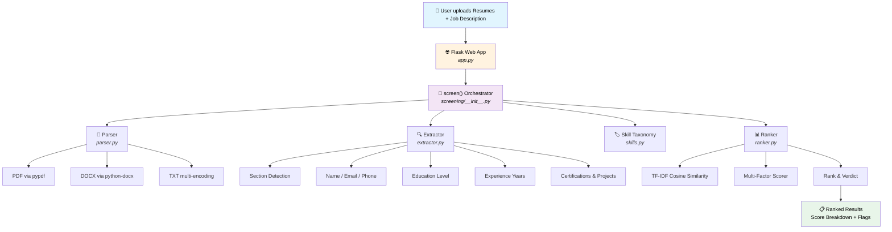
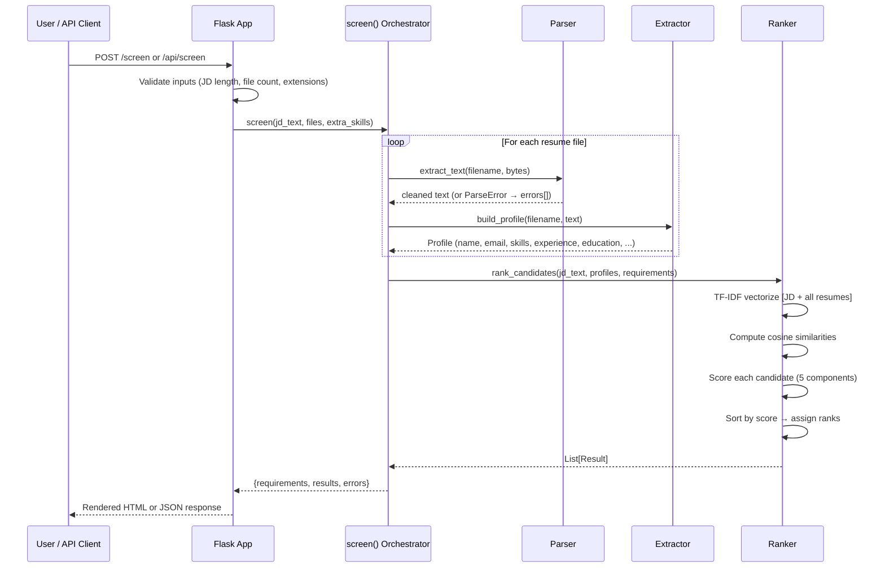
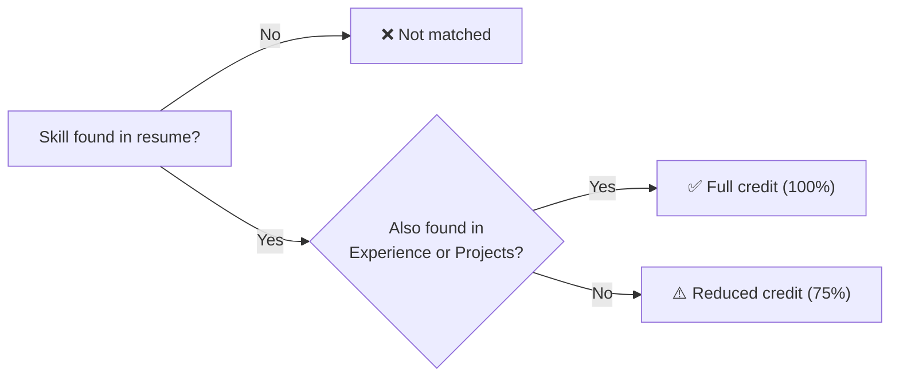

<div align="center">

# 📄 Smart Resume Screening & Candidate Ranking Tool

**An intelligent, NLP-powered resume screening system that parses, analyzes, and ranks candidates against job descriptions — in seconds.**

[](https://www.python.org/)
[](https://flask.palletsprojects.com/)
[](https://scikit-learn.org/)
[](LICENSE)
[](#-testing)
[](https://peps.python.org/pep-0008/)

---

*Paste a job description, upload resumes (PDF / DOCX / TXT), and get an instant ranked shortlist with detailed AI-driven scoring breakdowns.*

</div>

---

## 📑 Table of Contents

- [✨ Features](#-features)
- [🏗️ Architecture](#️-architecture)
- [🧠 How the AI / NLP Pipeline Works](#-how-the-ai--nlp-pipeline-works)
- [🚀 Quick Start](#-quick-start)
- [📡 API Reference](#-api-reference)
- [🧪 Testing](#-testing)
- [🔒 Security & Privacy](#-security--privacy)
- [📁 Project Structure](#-project-structure)
- [⚙️ Configuration](#️-configuration)
- [🤔 Limitations & Future Work](#-limitations--future-work)
- [🤝 Contributing](#-contributing)
- [📄 License](#-license)

---

## ✨ Features

- **Multi-Format Parsing** — Reads **PDF**, **DOCX**, and **TXT** resumes with robust error handling for encrypted, corrupt, or scanned files.
- **65+ Skill Taxonomy** — Recognizes programming languages, frameworks, databases, cloud platforms, DevOps tools, and soft skills with alias-aware matching (e.g., `k8s` → Kubernetes, `sklearn` → scikit-learn).
- **Smart Boundary Detection** — Custom regex word boundaries prevent false matches: *Java* never matches inside *JavaScript*; *C++*, *C#*, *.NET*, *Node.js* all match correctly.
- **NLP Resume Sectioning** — Automatically segments resumes into Skills, Experience, Education, Projects, Certifications, and Summary sections.
- **Experience Calculation** — Parses date ranges (`Jan 2020 – Present`), merges overlapping intervals, and computes total non-overlapping years of experience.
- **TF-IDF Cosine Similarity** — Measures semantic relevance between resumes and the job description using bigram TF-IDF vectors — goes beyond simple keyword matching.
- **Multi-Factor Scoring (0–100)** — Weighted composite of skill match (45%), text similarity (25%), experience (15%), education (10%), and certifications/projects (5%).
- **Anti-Keyword-Stuffing** — Skills that appear *only* in a skills list (not backed by evidence in experience/project sections) receive reduced credit.
- **Explainable Results** — Every candidate gets a full score breakdown, matched/missing skills, flags, and a verdict (`Strong` / `Good` / `Partial` / `Weak`).
- **Duplicate Detection** — Flags candidates with the same email address.
- **CSV Export** — Download results as CSV with formula-injection protection.
- **Drag-and-Drop Upload** — Modern UI with drag-and-drop file uploads and real-time validation.
- **REST API** — JSON API endpoint for programmatic integration.
- **Privacy-First** — All processing is in-memory; no files are stored on disk.

---

## 🏗️ Architecture



### Request Lifecycle



---

## 🧠 How the AI / NLP Pipeline Works

### 1. Document Parsing & Text Extraction

The parser ([`parser.py`](screening/parser.py)) safely extracts plain text from three formats:

| Format | Library | Validation | Details |
|--------|---------|------------|---------|
| **PDF** | `pypdf` | Magic-byte check (`%PDF` header) | Handles encrypted PDFs gracefully; capped at **30 pages** |
| **DOCX** | `python-docx` | ZIP structure validation | Extracts paragraphs + table cell text |
| **TXT** | stdlib | Multi-encoding fallback | UTF-8-sig → UTF-16 → Latin-1 → replace |

**Text Cleaning Pipeline:**
```
Raw text → Remove null bytes → Normalize \r\n → Collapse whitespace → Reduce excessive newlines → Cap at 200K chars
```

---

### 2. Resume Section Detection (NLP)

The extractor ([`extractor.py`](screening/extractor.py)) segments resumes into **7 section types** using regex-based heading recognition:

| Section | Example Headings Matched |
|---------|-------------------------|
| **Skills** | `Technical Skills`, `Key Skills`, `Core Competencies`, `Technologies`, `Tech Stack` |
| **Experience** | `Work Experience`, `Professional Experience`, `Employment History`, `Internships` |
| **Education** | `Education`, `Academic Background`, `Qualifications` |
| **Projects** | `Projects`, `Academic Projects`, `Personal Projects`, `Key Projects` |
| **Certifications** | `Certifications`, `Licenses`, `Courses`, `Training` |
| **Summary** | `Professional Summary`, `Career Objective`, `About Me` |
| **Other** | `Awards`, `Achievements`, `Publications`, `Languages`, `Hobbies` |

Lines are stripped of bullet characters (`•●▪○-–—`), pipe characters, and formatting markers before matching. Only short lines (≤ 40 chars) are considered as potential headings.

---

### 3. Named Entity Extraction

| Entity | Method | Details |
|--------|--------|---------|
| **Name** | Heuristic scan of the first 8 non-empty lines | Filters out headings, URLs, emails; looks for 2–4 word lines where every word matches `[A-Za-z][A-Za-z.'-]*` |
| **Email** | Regex | `[A-Za-z0-9._%+-]+@[A-Za-z0-9.-]+\.[A-Za-z]{2,}` |
| **Phone** | Regex + validation | 10–13 digit numbers; filters out year sequences (e.g., `2015 - 2019` is *not* a phone number) |

---

### 4. Skill Detection with Taxonomy Matching

The skill taxonomy ([`skills.py`](screening/skills.py)) contains **65+ canonical skills** organized into 7 categories, each with multiple aliases:

```
Languages         Python, Java, JavaScript, TypeScript, C++, C#, Go, Rust, SQL, ...
Web / Backend     React, Angular, Vue, Node.js, Django, Flask, FastAPI, Spring Boot, .NET, ...
Data / AI         Machine Learning, Deep Learning, NLP, LLMs, Pandas, TensorFlow, PyTorch, ...
Databases         MySQL, PostgreSQL, MongoDB, Redis, Elasticsearch, ...
Cloud / DevOps    AWS, Azure, GCP, Docker, Kubernetes, Terraform, CI/CD, Git, ...
Engineering       Agile, OOP, System Design, Unit Testing, Data Structures & Algorithms, ...
Soft Skills       Communication, Leadership, Problem Solving, Teamwork, Project Management
```

**Custom Word-Boundary Regex** prevents false positives:

```python
# Pattern template:
(?<![\w+#.])(?:alias1|alias2|...)(?![\w+#])

# Example: "Java" matches "Java" but NOT "JavaScript"
# Example: "C++" matches because + is in the boundary exclusion set
```

All compiled patterns are **LRU-cached** for performance. The `canonicalize()` function maps user-typed skills (e.g., `"k8s"`) to their canonical name (`"Kubernetes"`).

---

### 5. Education & Experience Extraction

#### Education Detection

Hierarchical pattern matching across 4 degree levels:

| Level | Label | Example Patterns Matched |
|-------|-------|--------------------------|
| **4** | PhD | `PhD`, `Ph.D`, `Doctorate`, `Doctoral` |
| **3** | Master's | `Master's`, `M.Tech`, `M.E.`, `M.Sc`, `MBA`, `MCA`, `Post-Graduate` |
| **2** | Bachelor's | `Bachelor's`, `B.Tech`, `B.E.`, `B.Sc`, `BCA`, `BBA`, `Undergraduate` |
| **1** | Diploma | `Diploma`, `Associate's Degree`, `Polytechnic` |

#### Experience Calculation (Interval Merging Algorithm)

The system parses date ranges from the *experience section only* (education dates are excluded):

```
"Jan 2020 - Dec 2022"    →  (2020-01, 2022-12)
"06/2018 - Present"      →  (2018-06, today)
"2019 - 2021"            →  (2019-01, 2021-01)
```

**Overlapping intervals are merged** to avoid double-counting concurrent roles:

```
Input:   |---Role A---|
              |---Role B---|
Merged:  |-------Total-------|
```

Falls back to explicit statements (e.g., `"5+ years of experience"`) when no parseable date ranges are found.

---

### 6. TF-IDF Cosine Similarity

The ranker ([`ranker.py`](screening/ranker.py)) uses **TF-IDF (Term Frequency–Inverse Document Frequency)** to measure semantic relevance beyond exact keyword matching.

**Configuration:**
```python
TfidfVectorizer(
    stop_words="english",     # Remove common words (the, is, at, ...)
    ngram_range=(1, 2),       # Capture unigrams + bigrams ("machine learning")
    sublinear_tf=True         # Apply 1 + log(tf) dampening
)
```

**How it works:**

1. Build a TF-IDF matrix for the corpus `[job_description, resume₁, resume₂, ...]`
2. For each resume, compute cosine similarity with the job description:

$$
\text{cosine\_similarity}(\vec{jd}, \vec{r}) = \frac{\vec{jd} \cdot \vec{r}}{|\vec{jd}| \times |\vec{r}|}
$$

3. Cap at `SIM_CAP = 0.5` — any similarity ≥ 0.5 earns 100% on this component:

$$
\text{similarity\_score} = \min\left(1,\ \frac{\text{cosine\_sim}}{0.5}\right) \times 100
$$

> **Why bigrams?** Unigrams alone miss compound concepts. `"machine learning"` as a bigram is more meaningful than `"machine"` and `"learning"` separately.

> **Why sublinear TF?** A skill mentioned 50 times shouldn't score 50× higher than one mentioned once. `1 + log(tf)` dampens this effect.

---

### 7. Multi-Factor Scoring Algorithm

Each candidate receives a composite score from **0 to 100** computed as a weighted sum of five components:

| Component | Weight | Calculation |
|-----------|--------|-------------|
| **Skills Match** | **45%** | `0.85 × required_score + 0.15 × preferred_score`. Each score = matched/total (with anti-stuffing adjustment) |
| **Text Similarity** | **25%** | TF-IDF cosine similarity (capped at 0.5 → 100) |
| **Experience** | **15%** | `min(1, actual_years / required_years) × 100` |
| **Education** | **10%** | Proportional degree-level comparison; meeting/exceeding requirement = 100 |
| **Certs & Projects** | **5%** | `30 pts per certification + 20 pts per project`, capped at 100 |

$$
\text{Score} = 0.45 \times S_{\text{skills}} + 0.25 \times S_{\text{similarity}} + 0.15 \times S_{\text{experience}} + 0.10 \times S_{\text{education}} + 0.05 \times S_{\text{extras}}
$$

**Verdict thresholds:**

| Score | Verdict |
|-------|---------|
| **≥ 75** | 🟢 **Strong Match** |
| **≥ 60** | 🔵 **Good Match** |
| **≥ 40** | 🟡 **Partial Match** |
| **< 40** | 🔴 **Weak Match** |

---

### 8. Anti-Keyword-Stuffing Mechanism

Skills that appear **only** in a skills-list section — with no evidence of actual use in experience or project descriptions — receive only **75% credit**:

```
LISTED_ONLY_CREDIT = 0.75
```



This rewards candidates who demonstrate **practical application** of skills rather than simply listing buzzwords.

---

### 9. Explainability Features

Every result includes a transparent breakdown:

- **Score Breakdown** — Individual scores for each of the 5 components
- **Matched Required Skills** — Which required skills the candidate has
- **Missing Required Skills** — Which required skills are absent
- **Matched Preferred Skills** — Bonus "nice-to-have" skills found
- **Listed-Only Skills** — Skills flagged as keyword-only (no evidence of use)
- **Flags** — Actionable warnings:
  - `"Missing 4 of 6 required skills"`
  - `"Experience (1.5 yrs) below required 3 yrs"`
  - `"Education below required Bachelor's"`
  - `"No readable text (scanned image PDF?) - cannot be scored"`
  - `"Possible duplicate of Jane Doe (same email)"`

---

## 🚀 Quick Start

### Prerequisites

- **Python 3.10** or later

### Installation

```bash
# Clone the repository
git clone https://github.com/your-username/resume-screener.git
cd resume-screener

# Create a virtual environment
python -m venv .venv

# Activate the virtual environment
# On Windows:
.venv\Scripts\activate
# On macOS/Linux:
source .venv/bin/activate

# Install dependencies
pip install -r requirements.txt
```

### Run the Development Server

```bash
python app.py
```

Open [http://127.0.0.1:5000](http://127.0.0.1:5000) in your browser.

### Run in Production

```bash
# Linux / macOS (gunicorn)
gunicorn app:app --bind 0.0.0.0:8000 --workers 4

# Windows (waitress)
waitress-serve --listen=0.0.0.0:8000 app:app
```

### Try the Sample Data

The [`sample_data/`](sample_data/) directory contains a sample job description and three sample resumes you can use to test the system immediately.

---

## 📡 API Reference

### `POST /api/screen`

Screen resumes against a job description programmatically.

**Content-Type:** `multipart/form-data`

| Field | Type | Required | Description |
|-------|------|----------|-------------|
| `jd_text` | `string` | ✅ | Job description text (30–20,000 chars) |
| `extra_skills` | `string` | ❌ | Comma-separated additional required skills |
| `resumes` | `file[]` | ✅ | Resume files (PDF, DOCX, or TXT). Max 30 files, 16 MB total |

**Example Request (cURL):**
```bash
curl -X POST http://127.0.0.1:5000/api/screen \
  -F "jd_text=We need a Python developer with 3+ years experience..." \
  -F "extra_skills=Docker, Kubernetes" \
  -F "resumes=@resume1.pdf" \
  -F "resumes=@resume2.docx"
```

**Example Response:**
```json
{
  "requirements": {
    "required_skills": ["Python", "Docker", "Kubernetes"],
    "preferred_skills": [],
    "min_years": 3.0,
    "min_education": "Bachelor's"
  },
  "results": [
    {
      "rank": 1,
      "filename": "resume1.pdf",
      "name": "Priya Sharma",
      "email": "priya@example.com",
      "phone": "+91 98765 43210",
      "skills": ["Python", "Docker", "Kubernetes", "AWS", "Flask"],
      "education_level": 2,
      "education_label": "Bachelor's",
      "education_detail": "B.Tech Computer Science, IIT Delhi",
      "experience_years": 4.5,
      "certifications": ["AWS Certified Solutions Architect"],
      "projects": ["ML Pipeline Orchestrator"],
      "word_count": 520,
      "score": 82.3,
      "label": "Strong match",
      "breakdown": {
        "skills": 95.0,
        "similarity": 68.4,
        "experience": 100.0,
        "education": 100.0,
        "extras": 50.0
      },
      "matched_required": ["Python", "Docker", "Kubernetes"],
      "missing_required": [],
      "matched_preferred": [],
      "listed_only": [],
      "flags": []
    }
  ],
  "errors": []
}
```

### `GET /health`

Health check endpoint. Returns `{"status": "ok"}`.

### Other Endpoints

| Endpoint | Method | Description |
|----------|--------|-------------|
| `GET /` | GET | Web UI — upload form |
| `POST /screen` | POST | Web UI — renders ranked results page |

---

## 🧪 Testing

The project includes **35 pytest tests** with comprehensive coverage across all modules.

### Running Tests

```bash
# Install test dependencies
pip install -r requirements-dev.txt

# Run all tests
pytest tests/ -v

# Run with coverage
pytest tests/ --cov=screening --cov-report=term-missing
```

### Test Coverage

| Area | Tests | What's Covered |
|------|-------|----------------|
| **Skill Matching** | 4 | Java vs JavaScript boundary, special chars (`C++`, `C#`, `.NET`), aliases, false positive prevention |
| **Extraction** | 6 | Contact info, phone vs year filtering, education levels, experience overlap merging, explicit years fallback |
| **Section Detection** | 1 | Correct splitting of resume into named sections |
| **Job Description Parsing** | 3 | Required vs preferred skills, degree extraction, extra skill canonicalization |
| **End-to-End Ranking** | 5 | Ranking order, listed-only credit reduction, duplicate detection, error resilience, similarity fallback |
| **Parser** | 2 | PDF/DOCX round-trip, rejection of invalid inputs |
| **Web App** | 6 | Home page, health check, security headers, HTML rendering, API JSON, validation errors |
| **Security** | 2 | XSS escaping in filenames/content, upload size limits |

---

## 🔒 Security & Privacy

| Measure | Implementation |
|---------|---------------|
| **In-Memory Processing** | Resume file bytes are processed in RAM and never written to disk |
| **Content Security Policy** | `default-src 'self'; script-src 'self'; style-src 'self'; frame-ancestors 'none'` |
| **X-Frame-Options** | `DENY` — prevents clickjacking |
| **X-Content-Type-Options** | `nosniff` — prevents MIME-type sniffing |
| **Referrer-Policy** | `no-referrer` |
| **Cache-Control** | `no-store` — sensitive results are not cached |
| **XSS Prevention** | Jinja2 autoescaping enabled on all templates |
| **Safe Filenames** | Werkzeug's `secure_filename()` sanitizes all uploaded filenames |
| **Upload Limits** | Max **16 MB** total upload size, max **30 files** per request |
| **CSV Injection Protection** | Exported CSV values are sanitized against formula injection |
| **Debug Mode** | Off by default — the Werkzeug debugger (which allows RCE) is never exposed |

---

## 📁 Project Structure

```
resume-screener/
├── app.py                          # Flask app — routes, validation, security headers
├── requirements.txt                # Runtime dependencies
├── requirements-dev.txt            # Test dependencies (pytest, reportlab)
├── README.md                       # This file
│
├── screening/                      # Core NLP screening engine
│   ├── __init__.py                 # Orchestrator — screen() entry point
│   ├── parser.py                   # PDF / DOCX / TXT text extraction
│   ├── extractor.py                # Resume profile extraction (NLP)
│   ├── ranker.py                   # TF-IDF similarity + multi-factor scoring
│   └── skills.py                   # 65+ skill taxonomy with alias matching
│
├── templates/                      # Jinja2 HTML templates
│   ├── base.html                   # Base layout (header, footer)
│   ├── index.html                  # Upload form page
│   └── results.html                # Ranked results display
│
├── static/                         # Frontend assets
│   ├── style.css                   # Full UI styling
│   ├── app.js                      # Client-side interactions (drag-drop, CSV)
│   └── sample/
│       └── job_description.txt     # Sample JD for the UI
│
├── sample_data/                    # Sample data for testing
│   ├── job_description.txt         # ML Engineer job description
│   ├── priya_sharma.pdf            # Sample resume (PDF)
│   ├── priya_sharma.txt            # Sample resume (TXT)
│   ├── anita_desai.pdf             # Sample resume (PDF)
│   ├── anita_desai.txt             # Sample resume (TXT)
│   └── rahul_verma.txt             # Sample resume (TXT)
│
└── tests/
    └── test_screening.py           # 35 pytest tests
```

---

## ⚙️ Configuration

Configuration is managed through **environment variables** and **constants** in `app.py`:

### Environment Variables

| Variable | Default | Description |
|----------|---------|-------------|
| `HOST` | `127.0.0.1` | Server bind address |
| `PORT` | `5000` | Server port |
| `FLASK_DEBUG` | _(off)_ | Set to `"1"` to enable debug mode (development only!) |

### Application Constants

| Constant | Location | Value | Description |
|----------|----------|-------|-------------|
| `MAX_FILES` | `app.py` | `30` | Maximum resume uploads per request |
| `MAX_UPLOAD_MB` | `app.py` | `16` | Maximum total upload size (MB) |
| `MIN_JD_CHARS` | `app.py` | `30` | Minimum job description length |
| `MAX_JD_CHARS` | `app.py` | `20,000` | Maximum job description length |
| `MAX_PDF_PAGES` | `parser.py` | `30` | Maximum PDF pages to read |
| `MAX_CHARS` | `parser.py` | `200,000` | Maximum characters per document |
| `SIM_CAP` | `ranker.py` | `0.5` | TF-IDF cosine similarity cap |
| `LISTED_ONLY_CREDIT` | `ranker.py` | `0.75` | Credit multiplier for listed-only skills |
| `WEIGHTS` | `ranker.py` | See scoring table | Component weight distribution |

---

## 🤔 Limitations & Future Work

### Current Limitations

- **No OCR** — Scanned image-based PDFs produce empty text; the system flags these but cannot extract content.
- **English Only** — Section headings, skill aliases, and NLP patterns are English-centric.
- **Rule-Based NLP** — Named entity recognition uses heuristics rather than ML models; edge cases in unusual resume formats may be missed.
- **No Persistent Storage** — Results are not saved between sessions (by design for privacy, but limits analytics).
- **Single-Machine** — No horizontal scaling or job queue; each request is processed synchronously.

### Future Enhancements

- 🔮 **LLM-Powered Extraction** — Use large language models for more nuanced section parsing and skill inference.
- 🖼️ **OCR Integration** — Add Tesseract or cloud OCR for scanned PDF support.
- 🌍 **Multi-Language Support** — Extend skill taxonomy and section detection to other languages.
- 📊 **Dashboard & Analytics** — Add persistent storage with trend analysis across screening sessions.
- 🔌 **ATS Integration** — Webhooks and integrations with popular Applicant Tracking Systems.
- 🧪 **A/B Scoring Models** — Allow configurable weight profiles for different industries/roles.
- 📝 **Cover Letter Analysis** — Extend the pipeline to analyze cover letters alongside resumes.

---

## 🤝 Contributing

Contributions are welcome! Here's how to get started:

1. **Fork** the repository
2. **Create** a feature branch (`git checkout -b feature/amazing-feature`)
3. **Install** dev dependencies (`pip install -r requirements-dev.txt`)
4. **Make** your changes
5. **Run** the test suite (`pytest tests/ -v`)
6. **Commit** your changes (`git commit -m 'Add amazing feature'`)
7. **Push** to the branch (`git push origin feature/amazing-feature`)
8. **Open** a Pull Request

### Development Setup

```bash
# Install all dependencies (runtime + test)
pip install -r requirements-dev.txt

# Run in debug mode
FLASK_DEBUG=1 python app.py

# Run tests with verbose output
pytest tests/ -v
```

---

## 📄 License

This project is licensed under the **MIT License** — see the [LICENSE](LICENSE) file for details.

---

<div align="center">

**Built with ❤️ using Python, Flask, and scikit-learn**

[⬆ Back to Top](#-smart-resume-screening--candidate-ranking-tool)

</div>
